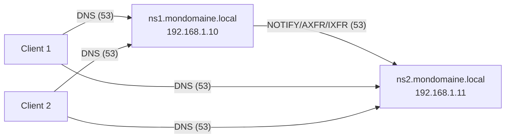

<!-- MASTER-HEADER-START -->
<div align="center">

<a href="https://0xcyberlitech.com/">
  
</a>

<p align="center">
  <a href="https://0xcyberlitech.com/"></a>
  <a href="https://0xcyberlitech.com/soc-rd.html"></a>
  <a href="https://0xcyberlitech.com/jarvis-rd.html"></a>
  <a href="https://github.com/0xCyberLiTech?tab=repositories"></a>
</p>
<p align="center">
  <a href="README.md"></a>
</p>


</div>
<!-- MASTER-HEADER-END -->

<!-- DEBIAN-TRUTH-START -->
> [!IMPORTANT]
>  ** Matrice Officielle Debian — `Debian 12 (Bookworm)` · `Debian 13 (Trixie)` · `Debian 14 (Forky)`**
> - **Sources Officielles Debian.org (`bind9`) :** `Bookworm (12)` : **`1:9.18.49-1~deb12u1`** &nbsp;·&nbsp; `Trixie (13 — Stable)` : **`1:9.20.26-1~deb13u1`** &nbsp;·&nbsp; `Forky (14 — Next-Gen)` : **`1:9.20.30-1`**
> - **Références Officielles :** [Paquet Debian Trixie (`bind9`)](https://packages.debian.org/trixie/bind9) &nbsp;·&nbsp; [Paquet Debian Forky (`bind9`)](https://packages.debian.org/forky/bind9) &nbsp;·&nbsp; [Documentation Officielle Debian](https://wiki.debian.org/Bind9)
> - **Note d'Ingénierie (Divergence 13 vs 14) :** Sous Debian 13 (Trixie) et Debian 14 (Forky), le démon BIND9 se pilote via l'unité systemd **`named.service`** (`systemctl restart named`) et les logs se lisent via `journalctl -u named`.

<details>
<summary> <b>Afficher les Encarts Ligne de Commande : Debian 13 (Trixie — Stable) vs Debian 14 (Forky — Next-Gen)</b></summary>

####  Profil Production Stable — Commandes pour `Debian 13 (Trixie)`
```bash
# Debian 13 (Trixie — BIND 9.20+) : Verification de syntaxe & statut du service nomme 'named'
sudo named-checkconf && sudo systemctl restart named
dig @127.0.0.1 localhost +dnssec
```

####  Profil Anticipation Next-Gen — Commandes pour `Debian 14 (Forky)`
```bash
# Debian 14 (Forky) — Unité systemd 'named.service' (l'alias bind9.service est deprecie) :
sudo systemctl status named.service
sudo journalctl -u named.service -f --no-hostname
```

</details>
<!-- DEBIAN-TRUTH-END -->

<!-- CIEL-PEDAGOGY-START -->
<details>
<summary> <b>Synthèse d'Architecture, Standards Officiels &amp; Diagnostic (Niveau 1 : Fondamentaux · Niveau 2 : Repères · Niveau 3 : Diagnostic)</b></summary>

- **Niveau 1 — Fondamentaux &amp; Principe d'Architecture :** Le service **DNS (BIND9 / Unbound)** assure la résolution bidirectionnelle entre les noms de domaine pleinement qualifiés (**FQDN**) et les adresses IP (`A` en IPv4, `AAAA` en IPv6, `PTR` en résolution inverse), constituant le socle critique de tout réseau d'entreprise.
- **Niveau 2 — Repères Officiels (Ports IANA, Fichiers Debian &amp; Commandes de Validation) :** **Ports IANA :** `UDP 53` (Résolution standard) & `TCP 53` (Transferts de zone AXFR/IXFR & DNSSEC) · `TCP 853` (DNS-over-TLS) &nbsp;|&nbsp; **Fichiers Debian :** `/etc/bind/named.conf.options`, `/etc/bind/named.conf.local` &nbsp;|&nbsp; **Validation officielle :** `sudo named-checkconf && sudo named-checkzone <zone> <fichier>`.
- **Niveau 3 — Diagnostic d'Incidents &amp; Ingénierie Avancée :** **Diagnostic & Architecture :** Toute modification d'un fichier de zone impose d'incrémenter le numéro **`Serial`** de l'enregistrement `SOA` avant d'exécuter `sudo rndc reload`. En architecture sécurisée, séparez toujours le **résolveur récursif** (interne) du **serveur faisant autorité** (exposé) pour prévenir l'amplification DNS.
- **Sources de Vérité Officielles Éditeurs &amp; Standards :** [Documentation Officielle ISC BIND 9](https://bind9.readthedocs.io/) &nbsp;·&nbsp; [RFC 1035 (IETF DNS)](https://datatracker.ietf.org/doc/html/rfc1035) &nbsp;·&nbsp; [Wiki Officiel Debian BIND9](https://wiki.debian.org/Bind9)

</details>
<!-- CIEL-PEDAGOGY-END -->


#  TP pas à pas — Installation & configuration d’un **serveur DNS Esclave (Secondaire)** avec **BIND9** sous **Debian 12 (Bookworm), Debian 13 (Trixie) & Debian 14 (Forky)**

> **Objectif pédagogique**  
> Déployer un **serveur DNS secondaire** (esclave) synchronisé automatiquement avec un **DNS maître**, pour assurer **redondance**, **haute disponibilité**, et **sécurité** (TSIG).  
> À la fin du TP, vous aurez :
> 1) un **ns1** (maître) qui notifie et autorise ns2,  
> 2) un **ns2** (esclave) qui réplique les zones (AXFR/IXFR),  
> 3) des **tests** de transfert, de résolution et de bascule,  
> 4) une **sécurisation** avec **TSIG** et pare‑feu.

---

##  01 // 0) Contexte, prérequis & topologie


- **DNS Maître** : `ns1.mondomaine.local` — **192.168.1.10**
- **DNS Esclave** : `ns2.mondomaine.local` — **192.168.1.11**
- **Zones** : `mondomaine.local` (directe) et `1.168.192.in-addr.arpa` (inverse)
- **Clients** : utilisent **deux DNS** (ns1 & ns2)

> **Version attendue** (Debian 12 (Bookworm), Debian 13 (Trixie) & Debian 14 (Forky)) : `named -v` → **BIND 9.18.x**

###  Schéma ASCII

<!-- CODE-WINDOW-START -->
> [!CAUTION]
> 
>
> ```bash
>           ┌───────────────┐
>           │  ns1 (Maître) │ 192.168.1.10
>           └───────▲───────┘
>                   │  NOTIFY + AXFR/IXFR (53/UDP+TCP)
>                   ▼
>           ┌───────────────┐
>           │ ns2 (Esclave) │ 192.168.1.11
>           └───────┬───────┘
>                   │  DNS 53/UDP+TCP
>      ┌────────────┴─────────────┐
>      │                          │
>  ┌───────┐                 ┌───────┐
>  │Client │                 │Client │
>  └───────┘                 └───────┘
>  (résolveurs = ns1 & ns2)
> ```
<!-- CODE-WINDOW-END -->

###  Schéma Mermaid (coller dans https://mermaid.live/)


---

##  02 // 1) Préparation sur **ns1 (Maître)**


###  1.1 Autoriser ns2 et notifier les changements
Éditer **/etc/bind/named.conf.local** sur **ns1** :

<!-- CODE-WINDOW-START -->
> [!CAUTION]
> 
>
> ```bash
> zone "mondomaine.local" {
>     type master;
>     file "/etc/bind/db.mondomaine.local";
>     allow-transfer { 192.168.1.11; };     // Autoriser l'esclave
>     also-notify   { 192.168.1.11; };      // Notifier ns2 à chaque modif
> };
>
> zone "1.168.192.in-addr.arpa" {
>     type master;
>     file "/etc/bind/db.192.168.1";
>     allow-transfer { 192.168.1.11; };
>     also-notify   { 192.168.1.11; };
> };
> ```
<!-- CODE-WINDOW-END -->

> **Bonnes pratiques** : créer une ACL (ex. `acl "dns-slaves" { 192.168.1.11; };`) et l’utiliser dans toutes les zones.

Rechargez la conf :

<!-- CODE-WINDOW-START -->
> [!CAUTION]
> 
>
> ```bash
> sudo rndc reload
> ```
<!-- CODE-WINDOW-END -->

###  1.2 Vérifier que les zones du maître sont correctes

<!-- CODE-WINDOW-START -->
> [!CAUTION]
> 
>
> ```bash
> sudo named-checkconf
> sudo named-checkzone mondomaine.local /etc/bind/db.mondomaine.local
> sudo named-checkzone 1.168.192.in-addr.arpa /etc/bind/db.192.168.1
> ```
<!-- CODE-WINDOW-END -->

---

##  03 // 2) Installation de BIND9 sur **ns2 (Esclave)**


<!-- CODE-WINDOW-START -->
> [!CAUTION]
> 
>
> ```bash
> sudo apt update && sudo apt -y upgrade
> sudo apt install -y bind9 bind9-utils bind9-dnsutils
> named -v   # BIND 9.18.x
> ```
<!-- CODE-WINDOW-END -->

---

##  04 // 3) Configuration **Esclave** sur ns2


###  3.1 Déclarer les zones secondaires
Éditer **/etc/bind/named.conf.local** sur **ns2** :

<!-- CODE-WINDOW-START -->
> [!CAUTION]
> 
>
> ```bash
> zone "mondomaine.local" {
>     type slave;                           // secondaire
>     masters { 192.168.1.10; };            // maître
>     file "/var/cache/bind/db.mondomaine.local";  // génération automatique
>     allow-notify { 192.168.1.10; };       // accepte NOTIFY du maître
> };
>
> zone "1.168.192.in-addr.arpa" {
>     type slave;
>     masters { 192.168.1.10; };
>     file "/var/cache/bind/db.192.168.1";
>     allow-notify { 192.168.1.10; };
> };
> ```
<!-- CODE-WINDOW-END -->

> **Note** : ne **créez pas** les fichiers de zone côté esclave ; ils se rempliront automatiquement au premier **AXFR/IXFR**.

###  3.2 Vérifier et démarrer

<!-- CODE-WINDOW-START -->
> [!CAUTION]
> 
>
> ```bash
> sudo named-checkconf
> sudo systemctl restart bind9
> sudo systemctl enable bind9
> systemctl status bind9 --no-pager
> journalctl -u bind9 -b --no-pager
> ```
<!-- CODE-WINDOW-END -->

###  3.3 Contrôler la présence des fichiers transférés

<!-- CODE-WINDOW-START -->
> [!CAUTION]
> 
>
> ```bash
> ls -l /var/cache/bind/
> ```
<!-- CODE-WINDOW-END -->

Vous devriez voir :

<!-- CODE-WINDOW-START -->
> [!CAUTION]
> 
>
> ```bash
> db.mondomaine.local
> db.192.168.1
> ```
<!-- CODE-WINDOW-END -->

---

##  05 // 4) Tests de **transfert** et de **résolution**


###  4.1 Tester la zone sur ns2

<!-- CODE-WINDOW-START -->
> [!CAUTION]
> 
>
> ```bash
> dig @192.168.1.11 mondomaine.local SOA +noall +answer
> dig @192.168.1.11 www.mondomaine.local A +noall +answer
> dig @192.168.1.11 -x 192.168.1.20 +noall +answer
> ```
<!-- CODE-WINDOW-END -->

###  4.2 Forcer un changement sur ns1 et vérifier la réplication
1. Sur **ns1**, modifiez un enregistrement (ex. `www`) et **incrémentez le Serial** dans le **SOA** de `db.mondomaine.local` (format conseillé `YYYYMMDDnn`).  
2. Rechargez la zone et notifiez :

<!-- CODE-WINDOW-START -->
> [!CAUTION]
> 
>
> ```bash
>    sudo rndc reload mondomaine.local
>    sudo rndc notify mondomaine.local
> ```
<!-- CODE-WINDOW-END -->

3. Sur **ns2**, surveillez les logs puis vérifiez le **Serial** :

<!-- CODE-WINDOW-START -->
> [!CAUTION]
> 
>
> ```bash
>    journalctl -u bind9 -f
>    dig @192.168.1.11 mondomaine.local SOA +noall +answer
> ```
<!-- CODE-WINDOW-END -->

> Le **Serial** doit être **identique** sur ns1 et ns2 après IXFR/AXFR.

###  4.3 Test de **bascule** (tolérance de panne)
1. Arrêter BIND9 sur ns1 :  

<!-- CODE-WINDOW-START -->
> [!CAUTION]
> 
>
> ```bash
>    sudo systemctl stop bind9   # sur ns1
> ```
<!-- CODE-WINDOW-END -->

2. Depuis un client, interroger ns2 :  

<!-- CODE-WINDOW-START -->
> [!CAUTION]
> 
>
> ```bash
>    dig @192.168.1.11 www.mondomaine.local +noall +answer
> ```
<!-- CODE-WINDOW-END -->

3. **Attendu** : ns2 répond toujours  

---

##  06 // 5) (Optionnel mais recommandé) **Sécuriser** le transfert avec **TSIG**


###  5.1 Générer une clé TSIG (sur ns1)

<!-- CODE-WINDOW-START -->
> [!CAUTION]
> 
>
> ```bash
> sudo tsig-keygen -a hmac-sha256 ns1-ns2-key > /etc/bind/keys/ns1-ns2.key
> sudo chown root:bind /etc/bind/keys/ns1-ns2.key
> sudo chmod 640 /etc/bind/keys/ns1-ns2.key
> ```
<!-- CODE-WINDOW-END -->

Le fichier contient un bloc `key` comme :

<!-- CODE-WINDOW-START -->
> [!CAUTION]
> 
>
> ```bash
> key "ns1-ns2-key" {
>     algorithm hmac-sha256;
>     secret "BASE64SECRET...";
> };
> ```
<!-- CODE-WINDOW-END -->

**Copiez** le contenu de ce bloc **à l’identique** sur **ns2** (ex. `/etc/bind/keys/ns1-ns2.key` avec les mêmes permissions).

###  5.2 Déclarer la clé et l’utiliser (ns1 & ns2)

####  Sur **ns1** (Maître)
Dans **/etc/bind/named.conf** (ou un fichier inclus, ex. `/etc/bind/named.conf.keys`) :

<!-- CODE-WINDOW-START -->
> [!CAUTION]
> 
>
> ```bash
> include "/etc/bind/keys/ns1-ns2.key";
>
> server 192.168.1.11 {
>     keys { "ns1-ns2-key"; };
> };
> ```
<!-- CODE-WINDOW-END -->

Dans **/etc/bind/named.conf.local**, remplacez/complétez :

<!-- CODE-WINDOW-START -->
> [!CAUTION]
> 
>
> ```bash
> zone "mondomaine.local" {
>     type master;
>     file "/etc/bind/db.mondomaine.local";
>     allow-transfer { key "ns1-ns2-key"; 192.168.1.11; };
>     also-notify   { 192.168.1.11 key "ns1-ns2-key"; };
> };
>
> zone "1.168.192.in-addr.arpa" {
>     type master;
>     file "/etc/bind/db.192.168.1";
>     allow-transfer { key "ns1-ns2-key"; 192.168.1.11; };
>     also-notify   { 192.168.1.11 key "ns1-ns2-key"; };
> };
> ```
<!-- CODE-WINDOW-END -->

####  Sur **ns2** (Esclave)
Dans **/etc/bind/named.conf** (ou inclus) :

<!-- CODE-WINDOW-START -->
> [!CAUTION]
> 
>
> ```bash
> include "/etc/bind/keys/ns1-ns2.key";
>
> server 192.168.1.10 {
>     keys { "ns1-ns2-key"; };
> };
> ```
<!-- CODE-WINDOW-END -->

Dans **/etc/bind/named.conf.local** :

<!-- CODE-WINDOW-START -->
> [!CAUTION]
> 
>
> ```bash
> zone "mondomaine.local" {
>     type slave;
>     masters { 192.168.1.10 key "ns1-ns2-key"; };
>     file "/var/cache/bind/db.mondomaine.local";
>     allow-notify { 192.168.1.10; };
> };
>
> zone "1.168.192.in-addr.arpa" {
>     type slave;
>     masters { 192.168.1.10 key "ns1-ns2-key"; };
>     file "/var/cache/bind/db.192.168.1";
>     allow-notify { 192.168.1.10; };
> };
> ```
<!-- CODE-WINDOW-END -->

Rechargez sur **les deux** :

<!-- CODE-WINDOW-START -->
> [!CAUTION]
> 
>
> ```bash
> sudo rndc reconfig
> sudo rndc reload
> ```
<!-- CODE-WINDOW-END -->

**Testez** que l’AXFR **échoue sans clé** et **réussit avec** :  
Depuis ns2, un AXFR explicite avec clé n’est pas lancé via `dig` (qui gère TSIG en ligne de commande), mais vous pouvez vérifier via les **logs** que le transfert s’effectue suite à un `NOTIFY` et qu’il est **signé**.  
> Bonus : `dig AXFR mondomaine.local @192.168.1.10` **devrait échouer** (REFUSED) si vous n’autorisez pas l’AXFR sans clé—c’est voulu.

---

##  07 // 6) Pare‑feu (UFW / nftables)


###  UFW — ouvrir DNS entre ns1 et ns2 + clients LAN

<!-- CODE-WINDOW-START -->
> [!CAUTION]
> 
>
> ```bash
> sudo ufw allow 53/udp
> sudo ufw allow 53/tcp
> # (Optionnel) limiter l'accès aux plages LAN :
> # sudo ufw allow from 192.168.1.0/24 to any port 53 proto udp
> # sudo ufw allow from 192.168.1.0/24 to any port 53 proto tcp
> sudo ufw reload
> sudo ufw status
> ```
<!-- CODE-WINDOW-END -->

###  nftables — exemple minimal (sur ns2)

<!-- CODE-WINDOW-START -->
> [!CAUTION]
> 
>
> ```bash
> table inet filter {
>   chain input {
>     type filter hook input priority 0;
>
>     iif "lo" accept
>     ct state established,related accept
>
>     # Autoriser DNS depuis le LAN
>     ip saddr 192.168.1.0/24 udp dport 53 accept
>     ip saddr 192.168.1.0/24 tcp dport 53 accept
>
>     # (Optionnel) restreindre davantage aux IP ns1/clients autorisés
>     # ip saddr 192.168.1.10 tcp dport 53 accept
>     # ip saddr 192.168.1.10 udp dport 53 accept
>
>     reject with icmpx type admin-prohibited
>   }
> }
> ```
<!-- CODE-WINDOW-END -->

Appliquer et activer :

<!-- CODE-WINDOW-START -->
> [!CAUTION]
> 
>
> ```bash
> sudo nft -f /etc/nftables.conf
> sudo systemctl enable nftables
> ```
<!-- CODE-WINDOW-END -->

---

##  08 // 7) Configuration des **clients** (résolveurs)


Configurer **deux serveurs DNS** (ordre différent possible selon vos politiques) :  
- Linux (ex. NetworkManager) : `nameserver 192.168.1.10` et `nameserver 192.168.1.11`  
- Windows : ajouter les deux DNS dans IPv4 de l’interface réseau

Tests depuis client :

<!-- CODE-WINDOW-START -->
> [!CAUTION]
> 
>
> ```bash
> dig www.mondomaine.local +noall +answer
> dig -x 192.168.1.20 +noall +answer
> ```
<!-- CODE-WINDOW-END -->

---

##  09 // 8) Dépannage — erreurs fréquentes & solutions


- **Transfert ne démarre pas** :  
  - vérifier `allow-transfer` sur **ns1** et `masters` sur **ns2**  
  - vérifier **pare‑feu** (TCP/53 pour AXFR, UDP/53 pour NOTIFY)  
  - consulter `journalctl -u bind9` sur ns1 et ns2
- **Serial identique mais ns2 pas à jour** :  
  - forcer `sudo rndc notify <zone>` et `sudo rndc reload <zone>` sur ns1  
  - supprimer une éventuelle zone cache sur ns2 : `sudo rm /var/cache/bind/db.mondomaine.local*` puis `sudo systemctl restart bind9`
- **AXFR non autorisé** via `dig AXFR` : normal si vous avez **bloqué** l’AXFR sans clé (sécurité souhaitable)
- **TSIG échec** : clés non identiques, permissions fichier (640, root:bind), include non chargé, horloge désynchronisée (NTP)
- **NXDOMAIN/SERVFAIL** : faute de frappe, FQDN sans point final, zone maître invalide → `named-checkzone`

---

##  10 // 9) Validation des acquis (quiz)


1. Quel port et protocole sont utilisés pour **AXFR** ?  
2. Quel champ **doit être incrémenté** à chaque changement de zone et pourquoi ?  
3. Comment **forcer** l’envoi d’un NOTIFY ?  
4. Pourquoi utiliser **TSIG** entre ns1 et ns2 ?  
5. Que vérifiez‑vous pour confirmer que ns2 est **synchronisé** ?

**Réponses attendues** :  
1) **TCP/53** (AXFR), NOTIFY en **UDP/53**.  
2) **Serial** du **SOA**, pour déclencher la réplication IXFR/AXFR.  
3) `sudo rndc notify <zone>` (ou `rndc reload` puis NOTIFY automatique).  
4) Authenticité et intégrité des transferts (éviter l’usurpation).  
5) Le **Serial** SOA identique entre ns1 et ns2 (`dig SOA`), et réponses cohérentes aux requêtes.

---

##  11 // 10) Annexes — modèles de fichiers


###  A) ns1 (Maître) — extraits

**/etc/bind/named.conf.options** (extrait minimal autorité)

<!-- CODE-WINDOW-START -->
> [!CAUTION]
> 
>
> ```bash
> options {
>     directory "/var/cache/bind";
>     listen-on { 127.0.0.1; 192.168.1.10; };
>     listen-on-v6 { none; };
>     recursion no;
>     allow-query { 127.0.0.1; 192.168.1.0/24; };
>     allow-transfer { none; }; // sur chaque zone : exception pour ns2
>     version "not disclosed";
> };
> ```
<!-- CODE-WINDOW-END -->

**/etc/bind/named.conf.local**

<!-- CODE-WINDOW-START -->
> [!CAUTION]
> 
>
> ```ini
> acl "dns-slaves" { 192.168.1.11; };
>
> zone "mondomaine.local" {
>     type master;
>     file "/etc/bind/db.mondomaine.local";
>     allow-transfer { dns-slaves; };
>     also-notify   { 192.168.1.11; };
> };
>
> zone "1.168.192.in-addr.arpa" {
>     type master;
>     file "/etc/bind/db.192.168.1";
>     allow-transfer { dns-slaves; };
>     also-notify   { 192.168.1.11; };
> };
> ```
<!-- CODE-WINDOW-END -->

###  B) ns2 (Esclave) — extraits

**/etc/bind/named.conf.options**

<!-- CODE-WINDOW-START -->
> [!CAUTION]
> 
>
> ```bash
> options {
>     directory "/var/cache/bind";
>     listen-on { 127.0.0.1; 192.168.1.11; };
>     listen-on-v6 { none; };
>     recursion no;
>     allow-query { 127.0.0.1; 192.168.1.0/24; };
>     allow-transfer { none; };
>     version "not disclosed";
> };
> ```
<!-- CODE-WINDOW-END -->

**/etc/bind/named.conf.local**

<!-- CODE-WINDOW-START -->
> [!CAUTION]
> 
>
> ```bash
> zone "mondomaine.local" {
>     type slave;
>     masters { 192.168.1.10; };
>     file "/var/cache/bind/db.mondomaine.local";
>     allow-notify { 192.168.1.10; };
> };
>
> zone "1.168.192.in-addr.arpa" {
>     type slave;
>     masters { 192.168.1.10; };
>     file "/var/cache/bind/db.192.168.1";
>     allow-notify { 192.168.1.10; };
> };
> ```
<!-- CODE-WINDOW-END -->

###  C) TSIG — bloc `key` (à inclure des **deux** côtés)

<!-- CODE-WINDOW-START -->
> [!CAUTION]
> 
>
> ```bash
> key "ns1-ns2-key" {
>     algorithm hmac-sha256;
>     secret "BASE64SECRET...";
> };
> ```
<!-- CODE-WINDOW-END -->

> **Remarques terminologie** : BIND et la doc récente parlent parfois de **primary/secondary** en plus de **master/slave**. Sous Debian 12 BIND 9.18, `type slave;` reste valable.

---

**Fin du TP **

Vous avez un **DNS esclave** fonctionnel, testé, et sécurisé (TSIG), prêt à soutenir la production.

<!-- MASTER-FOOTER-START -->
<div align="center">


<a href="https://0xcyberlitech.com/">
  
</a>

<p align="center"><a href="https://0xcyberlitech.com/"></a></p>

<sub><b>Architecturé &amp; Forgé par Marc &amp; Antigravity (Google DeepMind)</b> &nbsp;·&nbsp; <a href="https://0xcyberlitech.com/"><b>0xcyberlitech.com</b></a> &nbsp;·&nbsp; <a href="https://0xcyberlitech.com/soc-rd.html">Architecture SOC Cockpit v5.5</a> &nbsp;·&nbsp; <a href="https://0xcyberlitech.com/jarvis-rd.html">Architecture JARVIS Mark-VII</a> &nbsp;·&nbsp; <a href="https://0xcyberlitech.com/blueprint-jarvis.html">Blueprint Matériel RTX 5080</a></sub>

</div>
<!-- MASTER-FOOTER-END -->
