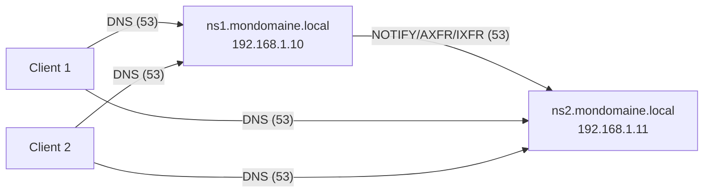

<!-- MASTER-HEADER-START -->
<div align="center">

<a href="https://0xcyberlitech.com/">
  
</a>

<p align="center">
  <a href="https://0xcyberlitech.com/"></a>
  <a href="https://0xcyberlitech.com/soc-rd.html"></a>
  <a href="https://0xcyberlitech.com/jarvis-rd.html"></a>
  <a href="https://github.com/0xCyberLiTech?tab=repositories"></a>
</p>
<p align="center">
  <a href="README.md"></a>
</p>


</div>
<!-- MASTER-HEADER-END -->

<!-- DEBIAN-TRUTH-START -->
> [!IMPORTANT]
>  ** Matrice Officielle Debian — `Debian 12 (Bookworm)` · `Debian 13 (Trixie)` · `Debian 14 (Forky)`**
> - **Sources Officielles Debian.org (`bind9`) :** `Bookworm (12)` : **`1:9.18.49-1~deb12u1`** &nbsp;·&nbsp; `Trixie (13 — Stable)` : **`1:9.20.26-1~deb13u1`** &nbsp;·&nbsp; `Forky (14 — Next-Gen)` : **`1:9.20.30-1`**
> - **Références Officielles :** [Paquet Debian Trixie (`bind9`)](https://packages.debian.org/trixie/bind9) &nbsp;·&nbsp; [Paquet Debian Forky (`bind9`)](https://packages.debian.org/forky/bind9) &nbsp;·&nbsp; [Documentation Officielle Debian](https://wiki.debian.org/Bind9)
> - **Note d'Ingénierie (Divergence 13 vs 14) :** Sous Debian 13 (Trixie) et Debian 14 (Forky), le démon BIND9 se pilote via l'unité systemd **`named.service`** (`systemctl restart named`) et les logs se lisent via `journalctl -u named`.

<details>
<summary> <b>Afficher les Encarts Ligne de Commande : Debian 13 (Trixie — Stable) vs Debian 14 (Forky — Next-Gen)</b></summary>

####  Profil Production Stable — Commandes pour `Debian 13 (Trixie)`
```bash
# Debian 13 (Trixie — BIND 9.20+) : Verification de syntaxe & statut du service nomme 'named'
sudo named-checkconf && sudo systemctl restart named
dig @127.0.0.1 localhost +dnssec
```

####  Profil Anticipation Next-Gen — Commandes pour `Debian 14 (Forky)`
```bash
# Debian 14 (Forky) — Unité systemd 'named.service' (l'alias bind9.service est deprecie) :
sudo systemctl status named.service
sudo journalctl -u named.service -f --no-hostname
```

</details>
<!-- DEBIAN-TRUTH-END -->

<!-- CIEL-PEDAGOGY-START -->
<details>
<summary> <b>Synthèse d'Architecture, Standards Officiels &amp; Diagnostic (Niveau 1 : Fondamentaux · Niveau 2 : Repères · Niveau 3 : Diagnostic)</b></summary>

- **Niveau 1 — Fondamentaux &amp; Principe d'Architecture :** Le service **DNS (BIND9 / Unbound)** assure la résolution bidirectionnelle entre les noms de domaine pleinement qualifiés (**FQDN**) et les adresses IP (`A` en IPv4, `AAAA` en IPv6, `PTR` en résolution inverse), constituant le socle critique de tout réseau d'entreprise.
- **Niveau 2 — Repères Officiels (Ports IANA, Fichiers Debian &amp; Commandes de Validation) :** **Ports IANA :** `UDP 53` (Résolution standard) & `TCP 53` (Transferts de zone AXFR/IXFR & DNSSEC) · `TCP 853` (DNS-over-TLS) &nbsp;|&nbsp; **Fichiers Debian :** `/etc/bind/named.conf.options`, `/etc/bind/named.conf.local` &nbsp;|&nbsp; **Validation officielle :** `sudo named-checkconf && sudo named-checkzone <zone> <fichier>`.
- **Niveau 3 — Diagnostic d'Incidents &amp; Ingénierie Avancée :** **Diagnostic & Architecture :** Toute modification d'un fichier de zone impose d'incrémenter le numéro **`Serial`** de l'enregistrement `SOA` avant d'exécuter `sudo rndc reload`. En architecture sécurisée, séparez toujours le **résolveur récursif** (interne) du **serveur faisant autorité** (exposé) pour prévenir l'amplification DNS.
- **Sources de Vérité Officielles Éditeurs &amp; Standards :** [Documentation Officielle ISC BIND 9](https://bind9.readthedocs.io/) &nbsp;·&nbsp; [RFC 1035 (IETF DNS)](https://datatracker.ietf.org/doc/html/rfc1035) &nbsp;·&nbsp; [Wiki Officiel Debian BIND9](https://wiki.debian.org/Bind9)
- **Livres Blancs &amp; 67 Podcasts Audio R&amp;D :** [Portail 0xCyberLiTech](https://0xcyberlitech.com/) &nbsp;·&nbsp; [Livre Blanc SOC Cockpit v5.5](https://0xcyberlitech.com/soc-rd.html) &nbsp;·&nbsp; [Livre Blanc JARVIS Mark-VII](https://0xcyberlitech.com/jarvis-rd.html) &nbsp;·&nbsp; [Blueprint Logiciel &amp; Matériel RTX 5080](https://0xcyberlitech.com/blueprint-jarvis.html)

</details>
<!-- CIEL-PEDAGOGY-END -->


#  TP pas à pas — Installation & configuration d’un **serveur DNS Esclave (Secondaire)** avec **BIND9** sous **Debian 13 (Trixie)**

> **Objectif pédagogique**  
> Déployer un **serveur DNS secondaire** (esclave) synchronisé automatiquement avec un **DNS maître**, pour assurer **redondance**, **haute disponibilité**, et **sécurité** (TSIG).  
> À la fin du TP, vous aurez :
> 1) un **ns1** (maître) qui notifie et autorise ns2,  
> 2) un **ns2** (esclave) qui réplique les zones (AXFR/IXFR),  
> 3) des **tests** de transfert, de résolution et de bascule,  
> 4) une **sécurisation** avec **TSIG** et pare‑feu.

---

##  01 // 0) Contexte, prérequis & topologie


- **DNS Maître** : `ns1.mondomaine.local` — **192.168.1.10**
- **DNS Esclave** : `ns2.mondomaine.local` — **192.168.1.11**
- **Zones** : `mondomaine.local` (directe) et `1.168.192.in-addr.arpa` (inverse)
- **Clients** : utilisent **deux DNS** (ns1 & ns2)

> **Version attendue** (Debian 13) : `named -v` → **BIND 9.20.x**

###  Schéma ASCII

<!-- CODE-WINDOW-START -->
> [!CAUTION]
> 
>
> ```bash
>           ┌───────────────┐
>           │  ns1 (Maître) │ 192.168.1.10
>           └───────▲───────┘
>                   │  NOTIFY + AXFR/IXFR (53/UDP+TCP)
>                   ▼
>           ┌───────────────┐
>           │ ns2 (Esclave) │ 192.168.1.11
>           └───────┬───────┘
>                   │  DNS 53/UDP+TCP
>      ┌────────────┴─────────────┐
>      │                          │
>  ┌───────┐                 ┌───────┐
>  │Client │                 │Client │
>  └───────┘                 └───────┘
>  (résolveurs = ns1 & ns2)
> ```
<!-- CODE-WINDOW-END -->

###  Schéma Mermaid (coller dans https://mermaid.live/)


---

##  02 // 1) Préparation sur **ns1 (Maître)**


###  1.1 Autoriser ns2 et notifier les changements
Éditer **/etc/bind/named.conf.local** sur **ns1** :

<!-- CODE-WINDOW-START -->
> [!CAUTION]
> 
>
> ```bash
> zone "mondomaine.local" {
>     type master;
>     file "/etc/bind/db.mondomaine.local";
>     allow-transfer { 192.168.1.11; };
>     also-notify   { 192.168.1.11; };
> };
>
> zone "1.168.192.in-addr.arpa" {
>     type master;
>     file "/etc/bind/db.192.168.1";
>     allow-transfer { 192.168.1.11; };
>     also-notify   { 192.168.1.11; };
> };
> ```
<!-- CODE-WINDOW-END -->

###  1.2 Vérifier les zones

<!-- CODE-WINDOW-START -->
> [!CAUTION]
> 
>
> ```bash
> sudo named-checkconf
> sudo named-checkzone mondomaine.local /etc/bind/db.mondomaine.local
> sudo named-checkzone 1.168.192.in-addr.arpa /etc/bind/db.192.168.1
> ```
<!-- CODE-WINDOW-END -->

---

##  03 // 2) Installation de BIND9 sur **ns2 (Esclave)**


<!-- CODE-WINDOW-START -->
> [!CAUTION]
> 
>
> ```bash
> sudo apt update && sudo apt -y upgrade
> sudo apt install -y bind9 bind9-utils bind9-dnsutils
> named -v   # BIND 9.20.x
> ```
<!-- CODE-WINDOW-END -->

---

##  04 // 3) Configuration **Esclave** sur ns2


###  3.1 Déclarer les zones secondaires
Éditer **/etc/bind/named.conf.local** sur **ns2** :

<!-- CODE-WINDOW-START -->
> [!CAUTION]
> 
>
> ```bash
> zone "mondomaine.local" {
>     type slave;
>     masters { 192.168.1.10; };
>     file "/var/cache/bind/db.mondomaine.local";
>     allow-notify { 192.168.1.10; };
> };
>
> zone "1.168.192.in-addr.arpa" {
>     type slave;
>     masters { 192.168.1.10; };
>     file "/var/cache/bind/db.192.168.1";
>     allow-notify { 192.168.1.10; };
> };
> ```
<!-- CODE-WINDOW-END -->

###  3.2 Vérifier et démarrer

<!-- CODE-WINDOW-START -->
> [!CAUTION]
> 
>
> ```bash
> sudo named-checkconf
> sudo systemctl restart bind9
> sudo systemctl enable bind9
> systemctl status bind9 --no-pager
> ```
<!-- CODE-WINDOW-END -->

###  3.3 Contrôler le transfert

<!-- CODE-WINDOW-START -->
> [!CAUTION]
> 
>
> ```bash
> ls -l /var/cache/bind/
> ```
<!-- CODE-WINDOW-END -->

Fichiers attendus :

<!-- CODE-WINDOW-START -->
> [!CAUTION]
> 
>
> ```bash
> db.mondomaine.local
> db.192.168.1
> ```
<!-- CODE-WINDOW-END -->

---

##  05 // 4) Tests


###  4.1 Vérifier la résolution

<!-- CODE-WINDOW-START -->
> [!CAUTION]
> 
>
> ```bash
> dig @192.168.1.11 mondomaine.local SOA +noall +answer
> dig @192.168.1.11 www.mondomaine.local A +noall +answer
> dig @192.168.1.11 -x 192.168.1.20 +noall +answer
> ```
<!-- CODE-WINDOW-END -->

###  4.2 Test de réplication
- Modifier une zone sur ns1, incrémenter le **Serial** du SOA  
- Recharger ns1 :  

<!-- CODE-WINDOW-START -->
> [!CAUTION]
> 
>
> ```bash
>   sudo rndc reload mondomaine.local
>   sudo rndc notify mondomaine.local
> ```
<!-- CODE-WINDOW-END -->

- Vérifier sur ns2 :  

<!-- CODE-WINDOW-START -->
> [!CAUTION]
> 
>
> ```bash
>   dig @192.168.1.11 mondomaine.local SOA +noall +answer
> ```
<!-- CODE-WINDOW-END -->

###  4.3 Test de bascule
- Arrêter ns1 : `sudo systemctl stop bind9`  
- Depuis client :  

<!-- CODE-WINDOW-START -->
> [!CAUTION]
> 
>
> ```bash
>   dig @192.168.1.11 www.mondomaine.local +noall +answer
> ```
<!-- CODE-WINDOW-END -->

-  ns2 doit répondre

---

##  06 // 5) Sécurisation avec TSIG


###  5.1 Générer une clé (sur ns1)

<!-- CODE-WINDOW-START -->
> [!CAUTION]
> 
>
> ```bash
> sudo tsig-keygen -a hmac-sha256 ns1-ns2-key > /etc/bind/keys/ns1-ns2.key
> ```
<!-- CODE-WINDOW-END -->

###  5.2 Déclarer la clé sur ns1 et ns2

####  ns1

<!-- CODE-WINDOW-START -->
> [!CAUTION]
> 
>
> ```bash
> include "/etc/bind/keys/ns1-ns2.key";
>
> server 192.168.1.11 {
>     keys { "ns1-ns2-key"; };
> };
> ```
<!-- CODE-WINDOW-END -->

Zones :

<!-- CODE-WINDOW-START -->
> [!CAUTION]
> 
>
> ```bash
> zone "mondomaine.local" {
>     type master;
>     file "/etc/bind/db.mondomaine.local";
>     allow-transfer { key "ns1-ns2-key"; 192.168.1.11; };
>     also-notify   { 192.168.1.11 key "ns1-ns2-key"; };
> };
> ```
<!-- CODE-WINDOW-END -->

####  ns2

<!-- CODE-WINDOW-START -->
> [!CAUTION]
> 
>
> ```bash
> include "/etc/bind/keys/ns1-ns2.key";
>
> server 192.168.1.10 {
>     keys { "ns1-ns2-key"; };
> };
>
> zone "mondomaine.local" {
>     type slave;
>     masters { 192.168.1.10 key "ns1-ns2-key"; };
>     file "/var/cache/bind/db.mondomaine.local";
> };
> ```
<!-- CODE-WINDOW-END -->

Recharge :

<!-- CODE-WINDOW-START -->
> [!CAUTION]
> 
>
> ```bash
> sudo rndc reconfig
> sudo rndc reload
> ```
<!-- CODE-WINDOW-END -->

---

##  07 // 6) Pare-feu


**UFW**

<!-- CODE-WINDOW-START -->
> [!CAUTION]
> 
>
> ```bash
> sudo ufw allow 53/udp
> sudo ufw allow 53/tcp
> sudo ufw reload
> ```
<!-- CODE-WINDOW-END -->

**nftables**

<!-- CODE-WINDOW-START -->
> [!CAUTION]
> 
>
> ```bash
> table inet filter {
>   chain input {
>     type filter hook input priority 0;
>     iif "lo" accept
>     ct state established,related accept
>     ip saddr 192.168.1.0/24 udp dport 53 accept
>     ip saddr 192.168.1.0/24 tcp dport 53 accept
>     reject with icmpx type admin-prohibited
>   }
> }
> ```
<!-- CODE-WINDOW-END -->

---

##  08 // 7) Configuration des clients


Clients → deux serveurs DNS :  

<!-- CODE-WINDOW-START -->
> [!CAUTION]
> 
>
> ```bash
> nameserver 192.168.1.10
> nameserver 192.168.1.11
> ```
<!-- CODE-WINDOW-END -->

---

##  09 // 8) Dépannage


- **Pas de transfert** : vérifier `allow-transfer` (ns1) et `masters` (ns2), firewall TCP/53
- **Serial pas synchro** : forcer `rndc notify <zone>` sur ns1
- **TSIG échec** : clé non identique, mauvais include, permissions fichier, horloge désynchronisée
- **NXDOMAIN** : fautes dans zone maître

Commandes utiles :

<!-- CODE-WINDOW-START -->
> [!CAUTION]
> 
>
> ```bash
> sudo named-checkconf
> sudo rndc reload
> journalctl -u bind9 -f
> ```
<!-- CODE-WINDOW-END -->

---

**Fin du TP **

<!-- MASTER-FOOTER-START -->
<div align="center">


<a href="https://0xcyberlitech.com/">
  
</a>

<p align="center"><a href="https://0xcyberlitech.com/"></a></p>

<sub><b>Architecturé &amp; Forgé par Marc &amp; Antigravity (Google DeepMind)</b> &nbsp;·&nbsp; <a href="https://0xcyberlitech.com/"><b>0xcyberlitech.com</b></a> &nbsp;·&nbsp; <a href="https://0xcyberlitech.com/soc-rd.html">Architecture SOC Cockpit v5.5</a> &nbsp;·&nbsp; <a href="https://0xcyberlitech.com/jarvis-rd.html">Architecture JARVIS Mark-VII</a> &nbsp;·&nbsp; <a href="https://0xcyberlitech.com/blueprint-jarvis.html">Blueprint Matériel RTX 5080</a></sub>

</div>
<!-- MASTER-FOOTER-END -->
