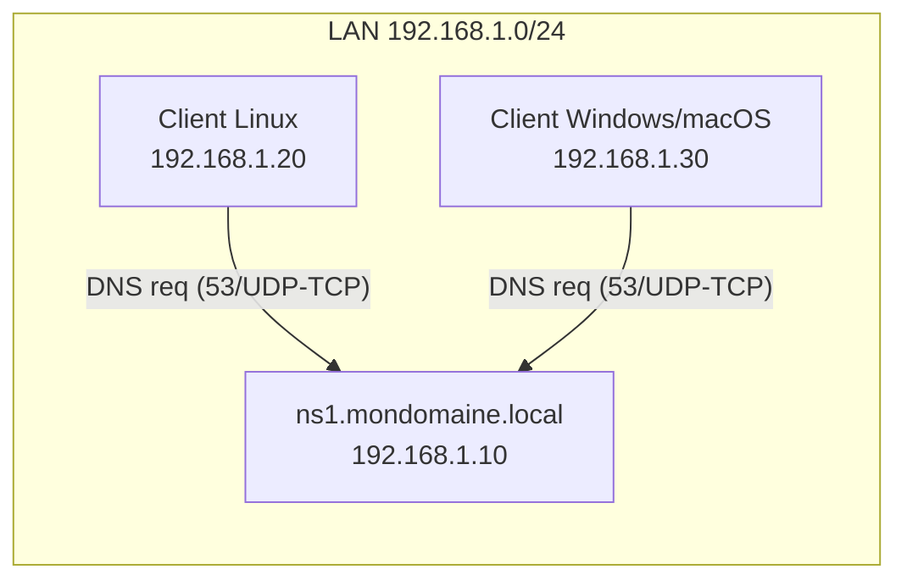

<!-- MASTER-HEADER-START -->
<div align="center">

<a href="https://0xcyberlitech.com/">
  
</a>

<p align="center">
  <a href="https://0xcyberlitech.com/"></a>
  <a href="https://0xcyberlitech.com/soc-rd.html"></a>
  <a href="https://0xcyberlitech.com/jarvis-rd.html"></a>
  <a href="https://github.com/0xCyberLiTech?tab=repositories"></a>
</p>
<p align="center">
  <a href="README.md"></a>
</p>


</div>
<!-- MASTER-HEADER-END -->

<!-- DEBIAN-TRUTH-START -->
> [!IMPORTANT]
>  ** Matrice Officielle Debian — `Debian 12 (Bookworm)` · `Debian 13 (Trixie)` · `Debian 14 (Forky)`**
> - **Sources Officielles Debian.org (`bind9`) :** `Bookworm (12)` : **`1:9.18.49-1~deb12u1`** &nbsp;·&nbsp; `Trixie (13 — Stable)` : **`1:9.20.26-1~deb13u1`** &nbsp;·&nbsp; `Forky (14 — Next-Gen)` : **`1:9.20.30-1`**
> - **Références Officielles :** [Paquet Debian Trixie (`bind9`)](https://packages.debian.org/trixie/bind9) &nbsp;·&nbsp; [Paquet Debian Forky (`bind9`)](https://packages.debian.org/forky/bind9) &nbsp;·&nbsp; [Documentation Officielle Debian](https://wiki.debian.org/Bind9)
> - **Note d'Ingénierie (Divergence 13 vs 14) :** Sous Debian 13 (Trixie) et Debian 14 (Forky), le démon BIND9 se pilote via l'unité systemd **`named.service`** (`systemctl restart named`) et les logs se lisent via `journalctl -u named`.

<details>
<summary> <b>Afficher les Encarts Ligne de Commande : Debian 13 (Trixie — Stable) vs Debian 14 (Forky — Next-Gen)</b></summary>

####  Profil Production Stable — Commandes pour `Debian 13 (Trixie)`
```bash
# Debian 13 (Trixie — BIND 9.20+) : Verification de syntaxe & statut du service nomme 'named'
sudo named-checkconf && sudo systemctl restart named
dig @127.0.0.1 localhost +dnssec
```

####  Profil Anticipation Next-Gen — Commandes pour `Debian 14 (Forky)`
```bash
# Debian 14 (Forky) — Unité systemd 'named.service' (l'alias bind9.service est deprecie) :
sudo systemctl status named.service
sudo journalctl -u named.service -f --no-hostname
```

</details>
<!-- DEBIAN-TRUTH-END -->

<!-- CIEL-PEDAGOGY-START -->
<details>
<summary> <b>Synthèse d'Architecture, Standards Officiels &amp; Diagnostic (Niveau 1 : Fondamentaux · Niveau 2 : Repères · Niveau 3 : Diagnostic)</b></summary>

- **Niveau 1 — Fondamentaux &amp; Principe d'Architecture :** Le service **DNS (BIND9 / Unbound)** assure la résolution bidirectionnelle entre les noms de domaine pleinement qualifiés (**FQDN**) et les adresses IP (`A` en IPv4, `AAAA` en IPv6, `PTR` en résolution inverse), constituant le socle critique de tout réseau d'entreprise.
- **Niveau 2 — Repères Officiels (Ports IANA, Fichiers Debian &amp; Commandes de Validation) :** **Ports IANA :** `UDP 53` (Résolution standard) & `TCP 53` (Transferts de zone AXFR/IXFR & DNSSEC) · `TCP 853` (DNS-over-TLS) &nbsp;|&nbsp; **Fichiers Debian :** `/etc/bind/named.conf.options`, `/etc/bind/named.conf.local` &nbsp;|&nbsp; **Validation officielle :** `sudo named-checkconf && sudo named-checkzone <zone> <fichier>`.
- **Niveau 3 — Diagnostic d'Incidents &amp; Ingénierie Avancée :** **Diagnostic & Architecture :** Toute modification d'un fichier de zone impose d'incrémenter le numéro **`Serial`** de l'enregistrement `SOA` avant d'exécuter `sudo rndc reload`. En architecture sécurisée, séparez toujours le **résolveur récursif** (interne) du **serveur faisant autorité** (exposé) pour prévenir l'amplification DNS.
- **Sources de Vérité Officielles Éditeurs &amp; Standards :** [Documentation Officielle ISC BIND 9](https://bind9.readthedocs.io/) &nbsp;·&nbsp; [RFC 1035 (IETF DNS)](https://datatracker.ietf.org/doc/html/rfc1035) &nbsp;·&nbsp; [Wiki Officiel Debian BIND9](https://wiki.debian.org/Bind9)

</details>
<!-- CIEL-PEDAGOGY-END -->


##  01 // TP pas à pas — Installation & configuration d’un **serveur DNS Maître** (BIND9) sous **Debian 12 (Bookworm), Debian 13 (Trixie) & Debian 14 (Forky)**


> **Objectif pédagogique**  
> À la fin de ce TP, vous saurez installer, configurer, tester et sécuriser un **serveur DNS maître** avec **BIND9** sur Debian 12 (Bookworm), Debian 13 (Trixie) & Debian 14 (Forky).  
> Vous créerez une **zone directe** et une **zone inverse**, vérifierez la configuration, puis effectuerez des tests de résolution depuis le serveur et un poste client.

---

##  02 // 0) Contexte, prérequis & topologie


###  Contexte
- Système : **Debian 12 (Bookworm)**, à jour
- Rôle : **DNS Maître** pour un domaine interne d’exemple `mondomaine.local`
- Hôte DNS : `ns1.mondomaine.local`
- IP fixe : `192.168.1.10/24` (passerelle `192.168.1.1`)

> Adaptez *domaine*, *noms d’hôtes* et *adresses IP* à votre environnement.

###  Pré-requis
- Accès `sudo` ou root
- Heure système correcte (NTP de préférence)
- Un poste client Linux (Debian/Ubuntu) ou Windows pour tester

###  Schéma de la topologie (ASCII)

<!-- CODE-WINDOW-START -->
> [!CAUTION]
> 
>
> ```bash
>              ┌───────────────────────────────────────────┐
>              │                Réseau LAN                 │
>              │                192.168.1.0/24             │
>              └───────────────────────────────────────────┘
>                         │
>                         │
>                 ┌───────┴────────┐
>                 │   DNS Maître   │
>                 │ ns1.mondomaine │
>                 │ 192.168.1.10   │
>                 └───────┬────────┘
>                         │
>         ┌───────────────┴────────────────┐
>         │                                │
> ┌───────▼────────┐                ┌──────▼────────┐
> │  Client Linux  │                │ Client Win/OS │
> │ 192.168.1.20   │                │ 192.168.1.30  │
> └────────────────┘                └───────────────┘
>         (utilisent ns1 = 192.168.1.10 comme résolveur primaire)
> ```
<!-- CODE-WINDOW-END -->

###  Schéma Mermaid (collable dans https://mermaid.live/)


---

##  03 // 1) Étape 1 — Préparer l’IP **statique** du serveur


1. Vérifier l’interface réseau :  

<!-- CODE-WINDOW-START -->
> [!CAUTION]
> 
>
> ```bash
>    ip -br a
> ```
<!-- CODE-WINDOW-END -->

2. Configurer l’IP statique via **systemd-networkd** ou **NetworkManager**. Exemple (NetworkManager, fichier keyfile) :

<!-- CODE-WINDOW-START -->
> [!CAUTION]
> 
>
> ```ini
>    # /etc/NetworkManager/system-connections/lan.nmconnection
>    [connection]
>    id=lan
>    type=ethernet
>    interface-name=eth0
>    autoconnect=true
>
>    [ipv4]
>    method=manual
>    addresses=192.168.1.10/24
>    gateway=192.168.1.1
>    dns=127.0.0.1;
>    dns-search=mondomaine.local;
>
>    [ipv6]
>    method=disabled
> ```
<!-- CODE-WINDOW-END -->

   Puis :

<!-- CODE-WINDOW-START -->
> [!CAUTION]
> 
>
> ```bash
>    sudo nmcli connection reload
>    sudo nmcli connection up lan
> ```
<!-- CODE-WINDOW-END -->

> **Pourquoi `dns=127.0.0.1` ?** Sur le **serveur DNS**, on résoudra en local via BIND9.  
> **Sur les clients**, on pointera vers **192.168.1.10** (ns1).

---

##  04 // 2) Étape 2 — Installer BIND9 et outils


<!-- CODE-WINDOW-START -->
> [!CAUTION]
> 
>
> ```bash
> sudo apt update && sudo apt -y upgrade
> sudo apt install -y bind9 bind9-utils bind9-dnsutils
> named -v     # doit afficher BIND 9.18.x (Debian 12)
> ```
<!-- CODE-WINDOW-END -->

Fichiers principaux utiles (Debian) :  
- `/etc/bind/named.conf` (inclut les autres)  
- `/etc/bind/named.conf.options` (options globales)  
- `/etc/bind/named.conf.local` (déclaration des zones locales)  
- `/var/cache/bind/` (cache, clés…)  
- Journaux via `journalctl -u bind9` (par défaut, AppArmor actif)

---

##  05 // 3) Étape 3 — Paramètres globaux de BIND9


Éditez **/etc/bind/named.conf.options** :

<!-- CODE-WINDOW-START -->
> [!CAUTION]
> 
>
> ```bash
> sudo nano /etc/bind/named.conf.options
> ```
<!-- CODE-WINDOW-END -->

Exemple **sécurisé pour un DNS d’autorité (maître)** dans un LAN :

<!-- CODE-WINDOW-START -->
> [!CAUTION]
> 
>
> ```bash
> options {
>     directory "/var/cache/bind";
>
>     // Écoute sur l’IPv4 locale et l’IP du LAN
>     listen-on { 127.0.0.1; 192.168.1.10; };
>     // Désactiver IPv6 si non utilisé
>     listen-on-v6 { none; };
>
>     // Ce serveur est d’autorité pour ses zones. Évitez la récursion aux non‑autorisés.
>     recursion no;
>
>     // Autoriser les requêtes pour nos zones à tout le LAN (ajustez votre plage)
>     allow-query { 127.0.0.1; 192.168.1.0/24; };
>
>     // Bloquer tout transfert de zone par défaut
>     allow-transfer { none; };
>
>     // Empêcher que la version BIND ne fuite via CHAOS TXT version.bind
>     version "not disclosed";
>
>     // DNSSEC (défaut activé côté BIND 9.18 pour la validation côté récursif)
>     // Ici non nécessaire pour l’autorité pure, on laisse la valeur par défaut.
>     // dnssec-validation auto;
>
>     // Réduire le délai des clients qui insistent (optionnel)
>     // rate-limit { responses-per-second 10; };
> };
> ```
<!-- CODE-WINDOW-END -->

Vérifiez la syntaxe :

<!-- CODE-WINDOW-START -->
> [!CAUTION]
> 
>
> ```bash
> sudo named-checkconf
> ```
<!-- CODE-WINDOW-END -->

---

##  06 // 4) Étape 4 — Déclarer les **zones** (fichier local)


Éditez **/etc/bind/named.conf.local** :

<!-- CODE-WINDOW-START -->
> [!CAUTION]
> 
>
> ```bash
> sudo nano /etc/bind/named.conf.local
> ```
<!-- CODE-WINDOW-END -->

Ajoutez **votre zone directe** et **zone inverse** :

<!-- CODE-WINDOW-START -->
> [!CAUTION]
> 
>
> ```bash
> zone "mondomaine.local" {
>     type master;
>     file "/etc/bind/db.mondomaine.local";
> };
>
> zone "1.168.192.in-addr.arpa" {
>     type master;
>     file "/etc/bind/db.192.168.1";
> };
> ```
<!-- CODE-WINDOW-END -->

> Remplacez `mondomaine.local` et la plage inverse `1.168.192` selon votre réseau.

---

##  07 // 5) Étape 5 — Créer la **zone directe** (db.mondomaine.local)


1. Partir d’un modèle :

<!-- CODE-WINDOW-START -->
> [!CAUTION]
> 
>
> ```bash
>    sudo cp /etc/bind/db.local /etc/bind/db.mondomaine.local
>    sudo nano /etc/bind/db.mondomaine.local
> ```
<!-- CODE-WINDOW-END -->

2. Exemple complet **commenté** :

<!-- CODE-WINDOW-START -->
> [!CAUTION]
> 
>
> ```bash
>    $TTL    86400          ; TTL par défaut (1 jour)
>    @       IN      SOA     ns1.mondomaine.local. admin.mondomaine.local. (
>                            2025083001 ; Serial (YYYYMMDDnn) — INCRÉMENTEZ à chaque modif
>                            3600       ; Refresh (secondes)
>                            1800       ; Retry
>                            1209600    ; Expire
>                            86400 )    ; Negative caching
>
>    ; Serveurs d’autorité (NS)
>    @       IN      NS      ns1.mondomaine.local.
>
>    ; Hôte du DNS maître
>    ns1     IN      A       192.168.1.10
>
>    ; Enregistrements principaux du domaine
>    @       IN      A       192.168.1.10          ; apex vers le serveur (si souhaité)
>    www     IN      A       192.168.1.20
>    mail    IN      A       192.168.1.30
>
>    ; Mail exchanger (MX)
>    @       IN      MX 10   mail.mondomaine.local.
>
>    ; Alias (CNAME) — exemples
>    intranet IN     CNAME   www.mondomaine.local.
>    web      IN     CNAME   www.mondomaine.local.
> ```
<!-- CODE-WINDOW-END -->

3. **Points d’attention**  
   - **FQDN en finissant par un point** pour les valeurs (ex. `mail.mondomaine.local.`)  
   - **Incrémentez le Serial** à chaque modification, sinon les changements ne seront pas pris en compte.

Vérifiez la zone :

<!-- CODE-WINDOW-START -->
> [!CAUTION]
> 
>
> ```bash
> sudo named-checkzone mondomaine.local /etc/bind/db.mondomaine.local
> ```
<!-- CODE-WINDOW-END -->

---

##  08 // 6) Étape 6 — Créer la **zone inverse** (db.192.168.1)


1. Partir d’un modèle :

<!-- CODE-WINDOW-START -->
> [!CAUTION]
> 
>
> ```bash
>    sudo cp /etc/bind/db.127 /etc/bind/db.192.168.1
>    sudo nano /etc/bind/db.192.168.1
> ```
<!-- CODE-WINDOW-END -->

2. Exemple **commenté** :

<!-- CODE-WINDOW-START -->
> [!CAUTION]
> 
>
> ```bash
>    $TTL    86400
>    @       IN      SOA     ns1.mondomaine.local. admin.mondomaine.local. (
>                            2025083001 ; Serial — incrémentez
>                            3600       ; Refresh
>                            1800       ; Retry
>                            1209600    ; Expire
>                            86400 )    ; Negative caching
>
>    @       IN      NS      ns1.mondomaine.local.
>
>    ; PTR pour les IP du LAN
>    10      IN      PTR     ns1.mondomaine.local.
>    20      IN      PTR     www.mondomaine.local.
>    30      IN      PTR     mail.mondomaine.local.
> ```
<!-- CODE-WINDOW-END -->

Vérifiez la zone :

<!-- CODE-WINDOW-START -->
> [!CAUTION]
> 
>
> ```bash
> sudo named-checkzone 1.168.192.in-addr.arpa /etc/bind/db.192.168.1
> ```
<!-- CODE-WINDOW-END -->

---

##  09 // 7) Étape 7 — Redémarrage, activation & statut


<!-- CODE-WINDOW-START -->
> [!CAUTION]
> 
>
> ```bash
> sudo systemctl restart bind9
> sudo systemctl enable bind9
> systemctl status bind9 --no-pager
> ```
<!-- CODE-WINDOW-END -->

Logs en cas d’erreurs :

<!-- CODE-WINDOW-START -->
> [!CAUTION]
> 
>
> ```bash
> journalctl -u bind9 -b --no-pager
> ```
<!-- CODE-WINDOW-END -->

---

##  10 // 8) Étape 8 — Tests de résolution (serveur & client)


###  Depuis le **serveur** (ns1)

<!-- CODE-WINDOW-START -->
> [!CAUTION]
> 
>
> ```bash
> # Requête A sur le domaine
> dig @127.0.0.1 mondomaine.local +noall +answer
>
> # Requête A sur un hôte
> dig @127.0.0.1 www.mondomaine.local +noall +answer
>
> # Requête MX
> dig @127.0.0.1 mondomaine.local MX +noall +answer
>
> # PTR (inverse) pour 192.168.1.20
> dig @127.0.0.1 -x 192.168.1.20 +noall +answer
> ```
<!-- CODE-WINDOW-END -->

###  Depuis un **client Linux**
Configurer le **résolveur** du client (par exemple `/etc/systemd/resolved.conf` ou `/etc/resolv.conf`) pour pointer vers **192.168.1.10**.

- Test :

<!-- CODE-WINDOW-START -->
> [!CAUTION]
> 
>
> ```bash
>   dig @192.168.1.10 www.mondomaine.local +noall +answer
>   host 192.168.1.30 192.168.1.10
> ```
<!-- CODE-WINDOW-END -->

###  Depuis un **client Windows**
- `nslookup`

<!-- CODE-WINDOW-START -->
> [!CAUTION]
> 
>
> ```powershell
>   nslookup
>   > server 192.168.1.10
>   > www.mondomaine.local
> ```
<!-- CODE-WINDOW-END -->

> **Attendus** : les réponses contiennent les **IP** que vous avez définies et les **NOMS** correspondants pour l’inverse.

---

##  11 // 9) Étape 9 — Pare-feu (UFW/iptables/nftables)


###  UFW

<!-- CODE-WINDOW-START -->
> [!CAUTION]
> 
>
> ```bash
> sudo ufw allow 53/udp
> sudo ufw allow 53/tcp
> sudo ufw reload
> sudo ufw status
> ```
<!-- CODE-WINDOW-END -->

###  nftables (exemple minimal)

<!-- CODE-WINDOW-START -->
> [!CAUTION]
> 
>
> ```bash
> sudo nano /etc/nftables.conf
> ```
<!-- CODE-WINDOW-END -->

Ajoutez (à adapter à votre politique) :

<!-- CODE-WINDOW-START -->
> [!CAUTION]
> 
>
> ```bash
> table inet filter {
>   chain input {
>     type filter hook input priority 0;
>
>     iif "lo" accept
>     ct state established,related accept
>
>     # Autoriser DNS UDP/TCP depuis le LAN
>     ip saddr 192.168.1.0/24 udp dport 53 accept
>     ip saddr 192.168.1.0/24 tcp dport 53 accept
>
>     # ... vos autres règles
>     reject with icmpx type admin-prohibited
>   }
> }
> ```
<!-- CODE-WINDOW-END -->

Puis :

<!-- CODE-WINDOW-START -->
> [!CAUTION]
> 
>
> ```bash
> sudo nft -f /etc/nftables.conf
> sudo systemctl enable nftables
> ```
<!-- CODE-WINDOW-END -->

---

##  12 // 10) Étape 10 — **Sécurisation** (bonnes pratiques)


- **Rôle autoritaire** : `recursion no;` déjà positionné (évite d’être un open‑resolver).
- **Limiter qui peut interroger** : `allow-query { 192.168.1.0/24; };` (ajustez).
- **Bloquer les transferts de zones** : `allow-transfer { none; };` (ou liste d’esclaves autorisés).
- **Cacher la version** : `version "not disclosed";` (limite le fingerprinting basique).
- **AppArmor** : actif par défaut sur Debian, garde-fou utile.
- **MCO** : Mettre à jour régulièrement (`apt upgrade`), surveiller les CVE BIND9.
- **Journalisation** : utilisez `journalctl -u bind9` ou configurez des `logging {}` dédiés (nécessite droits AppArmor pour fichiers ciblés).

> **Aller plus loin** : DNSSEC signé (ZSK/KSK), *Response Rate Limiting* (RRL), *Views* et *ACL*, *Split‑Horizon*, intégration avec IPAM/Ansible.

---

##  13 // 11) Questions de validation (rapides)


1. À quoi sert le **Serial** dans le SOA ?  
2. Quelle directive **désactive la récursion** sur un DNS d’autorité ?  
3. Pourquoi faut‑il un **PTR** dans la zone inverse ?  
4. Quelle commande permet de **valider** la syntaxe d’une **zone** ?  
5. Quelles sont les **deux** couches de transport utilisées par DNS ?

*Réponses attendues* : (1) déclencher/propager les mises à jour de zone ; (2) `recursion no;` ; (3) pour la résolution **inverse** IP→Nom ; (4) `named-checkzone` ; (5) **UDP** et **TCP** (port **53**).

---

##  14 // 12) Dépannage — erreurs fréquentes & solutions


- **SERVFAIL / NXDOMAIN** : vérifier l’orthographe des **FQDN** (points finaux), la cohérence A/MX/CNAME.  
- **`dns_rdata_fromtext` ou `unexpected end of file`** : erreur de syntaxe dans le fichier de zone (tabulations, espaces, `;`).  
- **Pas de réponse sur le client** : pare‑feu ou client ne pointe pas vers le bon **DNS primaire**.  
- **Zone inverse ne répond pas** : nom de **zone in‑addr.arpa** incorrect ou PTR manquant.  
- **Changement non pris en compte** : **Serial** non incrémenté ; redémarrer ou `rndc reload`.  

Commandes utiles :

<!-- CODE-WINDOW-START -->
> [!CAUTION]
> 
>
> ```bash
> sudo named-checkconf
> sudo named-checkzone mondomaine.local /etc/bind/db.mondomaine.local
> sudo named-checkzone 1.168.192.in-addr.arpa /etc/bind/db.192.168.1
> sudo rndc reload       # recharger proprement
> sudo rndc reconfig     # recharger la conf globale
> journalctl -u bind9 -f # suivre les logs en direct
> ```
<!-- CODE-WINDOW-END -->

---

##  15 // 13) Annexes — modèles prêts à l’emploi


**/etc/bind/named.conf.options**

<!-- CODE-WINDOW-START -->
> [!CAUTION]
> 
>
> ```bash
> options {
>     directory "/var/cache/bind";
>     listen-on { 127.0.0.1; 192.168.1.10; };
>     listen-on-v6 { none; };
>     recursion no;
>     allow-query { 127.0.0.1; 192.168.1.0/24; };
>     allow-transfer { none; };
>     version "not disclosed";
> };
> ```
<!-- CODE-WINDOW-END -->

**/etc/bind/named.conf.local**

<!-- CODE-WINDOW-START -->
> [!CAUTION]
> 
>
> ```bash
> zone "mondomaine.local" {
>     type master;
>     file "/etc/bind/db.mondomaine.local";
> };
>
> zone "1.168.192.in-addr.arpa" {
>     type master;
>     file "/etc/bind/db.192.168.1";
> };
> ```
<!-- CODE-WINDOW-END -->

**/etc/bind/db.mondomaine.local**

<!-- CODE-WINDOW-START -->
> [!CAUTION]
> 
>
> ```bash
> $TTL 86400
> @   IN  SOA ns1.mondomaine.local. admin.mondomaine.local. (
>         2025083001 ; Serial
>         3600       ; Refresh
>         1800       ; Retry
>         1209600    ; Expire
>         86400 )    ; Negative
>
> @       IN  NS      ns1.mondomaine.local.
> ns1     IN  A       192.168.1.10
> @       IN  A       192.168.1.10
> www     IN  A       192.168.1.20
> mail    IN  A       192.168.1.30
> @       IN  MX 10   mail.mondomaine.local.
> ```
<!-- CODE-WINDOW-END -->

**/etc/bind/db.192.168.1**

<!-- CODE-WINDOW-START -->
> [!CAUTION]
> 
>
> ```bash
> $TTL 86400
> @   IN  SOA ns1.mondomaine.local. admin.mondomaine.local. (
>         2025083001 ; Serial
>         3600
>         1800
>         1209600
>         86400 )
> @       IN  NS      ns1.mondomaine.local.
> 10      IN  PTR     ns1.mondomaine.local.
> 20      IN  PTR     www.mondomaine.local.
> 30      IN  PTR     mail.mondomaine.local.
> ```
<!-- CODE-WINDOW-END -->

---

##  16 // 14) (Optionnel) Préparer un **esclave** plus tard

Si vous déploierez un DNS **esclave** (ns2), remplacez `allow-transfer { none; };` par :

<!-- CODE-WINDOW-START -->
> [!CAUTION]
> 
>
> ```ini
> acl "dns-slaves" { 192.168.1.11; };     // IP de ns2
> allow-transfer { dns-slaves; };
> also-notify { 192.168.1.11; };          // notification de modifications
> ```
<!-- CODE-WINDOW-END -->

Puis déclarez la zone en `type slave;` sur ns2 avec `masters { 192.168.1.10; };`

---

**Fin du TP **

Vous avez un **DNS maître** fonctionnel, vérifié et raisonnablement **sécurisé** pour un LAN.

<!-- MASTER-FOOTER-START -->
<div align="center">


<a href="https://0xcyberlitech.com/">
  
</a>

<p align="center"><a href="https://0xcyberlitech.com/"></a></p>

<sub><b>Architecturé &amp; Forgé par Marc &amp; Antigravity (Google DeepMind)</b> &nbsp;·&nbsp; <a href="https://0xcyberlitech.com/"><b>0xcyberlitech.com</b></a> &nbsp;·&nbsp; <a href="https://0xcyberlitech.com/soc-rd.html">Architecture SOC Cockpit v5.5</a> &nbsp;·&nbsp; <a href="https://0xcyberlitech.com/jarvis-rd.html">Architecture JARVIS Mark-VII</a> &nbsp;·&nbsp; <a href="https://0xcyberlitech.com/blueprint-jarvis.html">Blueprint Matériel RTX 5080</a></sub>

</div>
<!-- MASTER-FOOTER-END -->
