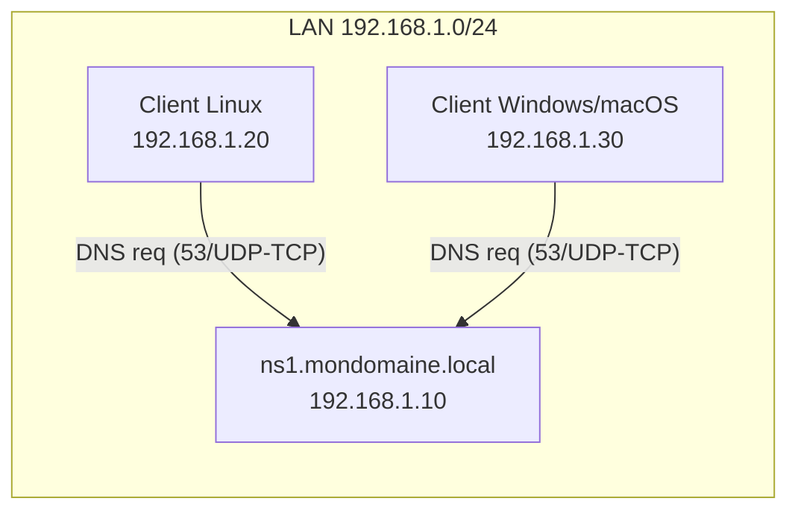

<!-- MASTER-HEADER-START -->
<div align="center">

<a href="https://0xcyberlitech.com/">
  
</a>

<p align="center">
  <a href="https://0xcyberlitech.com/"></a>
  <a href="https://0xcyberlitech.com/soc-rd.html"></a>
  <a href="https://0xcyberlitech.com/jarvis-rd.html"></a>
  <a href="https://github.com/0xCyberLiTech?tab=repositories"></a>
</p>
<p align="center">
  <a href="README.md"></a>
</p>


</div>
<!-- MASTER-HEADER-END -->

<!-- DEBIAN-TRUTH-START -->
> [!IMPORTANT]
>  ** Matrice Officielle Debian — `Debian 12 (Bookworm)` · `Debian 13 (Trixie)` · `Debian 14 (Forky)`**
> - **Sources Officielles Debian.org (`bind9`) :** `Bookworm (12)` : **`1:9.18.49-1~deb12u1`** &nbsp;·&nbsp; `Trixie (13 — Stable)` : **`1:9.20.26-1~deb13u1`** &nbsp;·&nbsp; `Forky (14 — Next-Gen)` : **`1:9.20.30-1`**
> - **Références Officielles :** [Paquet Debian Trixie (`bind9`)](https://packages.debian.org/trixie/bind9) &nbsp;·&nbsp; [Paquet Debian Forky (`bind9`)](https://packages.debian.org/forky/bind9) &nbsp;·&nbsp; [Documentation Officielle Debian](https://wiki.debian.org/Bind9)
> - **Note d'Ingénierie (Divergence 13 vs 14) :** Sous Debian 13 (Trixie) et Debian 14 (Forky), le démon BIND9 se pilote via l'unité systemd **`named.service`** (`systemctl restart named`) et les logs se lisent via `journalctl -u named`.

<details>
<summary> <b>Afficher les Encarts Ligne de Commande : Debian 13 (Trixie — Stable) vs Debian 14 (Forky — Next-Gen)</b></summary>

####  Profil Production Stable — Commandes pour `Debian 13 (Trixie)`
```bash
# Debian 13 (Trixie — BIND 9.20+) : Verification de syntaxe & statut du service nomme 'named'
sudo named-checkconf && sudo systemctl restart named
dig @127.0.0.1 localhost +dnssec
```

####  Profil Anticipation Next-Gen — Commandes pour `Debian 14 (Forky)`
```bash
# Debian 14 (Forky) — Unité systemd 'named.service' (l'alias bind9.service est deprecie) :
sudo systemctl status named.service
sudo journalctl -u named.service -f --no-hostname
```

</details>
<!-- DEBIAN-TRUTH-END -->

<!-- CIEL-PEDAGOGY-START -->
<details>
<summary> <b>Synthèse d'Architecture, Standards Officiels &amp; Diagnostic (Niveau 1 : Fondamentaux · Niveau 2 : Repères · Niveau 3 : Diagnostic)</b></summary>

- **Niveau 1 — Fondamentaux &amp; Principe d'Architecture :** Le service **DNS (BIND9 / Unbound)** assure la résolution bidirectionnelle entre les noms de domaine pleinement qualifiés (**FQDN**) et les adresses IP (`A` en IPv4, `AAAA` en IPv6, `PTR` en résolution inverse), constituant le socle critique de tout réseau d'entreprise.
- **Niveau 2 — Repères Officiels (Ports IANA, Fichiers Debian &amp; Commandes de Validation) :** **Ports IANA :** `UDP 53` (Résolution standard) & `TCP 53` (Transferts de zone AXFR/IXFR & DNSSEC) · `TCP 853` (DNS-over-TLS) &nbsp;|&nbsp; **Fichiers Debian :** `/etc/bind/named.conf.options`, `/etc/bind/named.conf.local` &nbsp;|&nbsp; **Validation officielle :** `sudo named-checkconf && sudo named-checkzone <zone> <fichier>`.
- **Niveau 3 — Diagnostic d'Incidents &amp; Ingénierie Avancée :** **Diagnostic & Architecture :** Toute modification d'un fichier de zone impose d'incrémenter le numéro **`Serial`** de l'enregistrement `SOA` avant d'exécuter `sudo rndc reload`. En architecture sécurisée, séparez toujours le **résolveur récursif** (interne) du **serveur faisant autorité** (exposé) pour prévenir l'amplification DNS.
- **Sources de Vérité Officielles Éditeurs &amp; Standards :** [Documentation Officielle ISC BIND 9](https://bind9.readthedocs.io/) &nbsp;·&nbsp; [RFC 1035 (IETF DNS)](https://datatracker.ietf.org/doc/html/rfc1035) &nbsp;·&nbsp; [Wiki Officiel Debian BIND9](https://wiki.debian.org/Bind9)

</details>
<!-- CIEL-PEDAGOGY-END -->


#  TP pas à pas — Installation & configuration d’un **serveur DNS Maître** (BIND9) sous **Debian 13 (Trixie)**

> **Objectif pédagogique**  
> À la fin de ce TP, vous saurez installer, configurer, tester et sécuriser un **serveur DNS maître** avec **BIND9** sur Debian 13.  
> Vous créerez une **zone directe** et une **zone inverse**, vérifierez la configuration, puis effectuerez des tests de résolution depuis le serveur et un poste client.

---

##  01 // 0) Contexte, prérequis & topologie


###  Contexte
- Système : **Debian 13 (Trixie)**, stable depuis août 2025
- Rôle : **DNS Maître** pour un domaine interne d’exemple `mondomaine.local`
- Hôte DNS : `ns1.mondomaine.local`
- IP fixe : `192.168.1.10/24` (passerelle `192.168.1.1`)

> Adaptez *domaine*, *noms d’hôtes* et *adresses IP* à votre environnement.

###  Pré-requis
- Accès `sudo` ou root
- Heure système correcte (NTP de préférence)
- Un poste client Linux (Debian/Ubuntu) ou Windows pour tester

###  Schéma de la topologie (ASCII)

<!-- CODE-WINDOW-START -->
> [!CAUTION]
> 
>
> ```bash
>              ┌───────────────────────────────────────────┐
>              │                Réseau LAN                 │
>              │                192.168.1.0/24             │
>              └───────────────────────────────────────────┘
>                         │
>                         │
>                 ┌───────┴────────┐
>                 │   DNS Maître   │
>                 │ ns1.mondomaine │
>                 │ 192.168.1.10   │
>                 └───────┬────────┘
>                         │
>         ┌───────────────┴────────────────┐
>         │                                │
> ┌───────▼────────┐                ┌──────▼────────┐
> │  Client Linux  │                │ Client Win/OS │
> │ 192.168.1.20   │                │ 192.168.1.30  │
> └────────────────┘                └───────────────┘
>         (utilisent ns1 = 192.168.1.10 comme résolveur primaire)
> ```
<!-- CODE-WINDOW-END -->

###  Schéma Mermaid (collable dans https://mermaid.live/)


---

##  02 // 1) Étape 1 — Préparer l’IP **statique** du serveur


1. Vérifier l’interface réseau :  

<!-- CODE-WINDOW-START -->
> [!CAUTION]
> 
>
> ```bash
>    ip -br a
> ```
<!-- CODE-WINDOW-END -->

2. Configurer l’IP statique via **systemd-networkd** ou **NetworkManager**. Exemple (NetworkManager, fichier keyfile) :

<!-- CODE-WINDOW-START -->
> [!CAUTION]
> 
>
> ```ini
>    # /etc/NetworkManager/system-connections/lan.nmconnection
>    [connection]
>    id=lan
>    type=ethernet
>    interface-name=eth0
>    autoconnect=true
>
>    [ipv4]
>    method=manual
>    addresses=192.168.1.10/24
>    gateway=192.168.1.1
>    dns=127.0.0.1;
>    dns-search=mondomaine.local;
>
>    [ipv6]
>    method=disabled
> ```
<!-- CODE-WINDOW-END -->

   Puis :

<!-- CODE-WINDOW-START -->
> [!CAUTION]
> 
>
> ```bash
>    sudo nmcli connection reload
>    sudo nmcli connection up lan
> ```
<!-- CODE-WINDOW-END -->

> **Pourquoi `dns=127.0.0.1` ?** Sur le **serveur DNS**, on résoudra en local via BIND9.  
> **Sur les clients**, on pointera vers **192.168.1.10** (ns1).

---

##  03 // 2) Étape 2 — Installer BIND9 et outils


<!-- CODE-WINDOW-START -->
> [!CAUTION]
> 
>
> ```bash
> sudo apt update && sudo apt -y upgrade
> sudo apt install -y bind9 bind9-utils bind9-dnsutils
> named -v     # doit afficher BIND 9.20.x (Debian 13)
> ```
<!-- CODE-WINDOW-END -->

Fichiers principaux utiles (Debian) :  
- `/etc/bind/named.conf` (inclut les autres)  
- `/etc/bind/named.conf.options` (options globales)  
- `/etc/bind/named.conf.local` (déclaration des zones locales)  
- `/var/cache/bind/` (cache, clés…)  
- Journaux via `journalctl -u bind9` (par défaut, AppArmor actif)

---

##  04 // 3) Étape 3 — Paramètres globaux de BIND9


Éditez **/etc/bind/named.conf.options** :

<!-- CODE-WINDOW-START -->
> [!CAUTION]
> 
>
> ```bash
> sudo nano /etc/bind/named.conf.options
> ```
<!-- CODE-WINDOW-END -->

Exemple **sécurisé pour un DNS d’autorité (maître)** dans un LAN :

<!-- CODE-WINDOW-START -->
> [!CAUTION]
> 
>
> ```bash
> options {
>     directory "/var/cache/bind";
>
>     listen-on { 127.0.0.1; 192.168.1.10; };
>     listen-on-v6 { none; };
>
>     recursion no;
>     allow-query { 127.0.0.1; 192.168.1.0/24; };
>     allow-transfer { none; };
>     version "not disclosed";
> };
> ```
<!-- CODE-WINDOW-END -->

Vérifiez la syntaxe :

<!-- CODE-WINDOW-START -->
> [!CAUTION]
> 
>
> ```bash
> sudo named-checkconf
> ```
<!-- CODE-WINDOW-END -->

---

##  05 // 4) Étape 4 — Déclarer les **zones** (fichier local)


Éditez **/etc/bind/named.conf.local** :

<!-- CODE-WINDOW-START -->
> [!CAUTION]
> 
>
> ```bash
> sudo nano /etc/bind/named.conf.local
> ```
<!-- CODE-WINDOW-END -->

Ajoutez **votre zone directe** et **zone inverse** :

<!-- CODE-WINDOW-START -->
> [!CAUTION]
> 
>
> ```bash
> zone "mondomaine.local" {
>     type master;
>     file "/etc/bind/db.mondomaine.local";
> };
>
> zone "1.168.192.in-addr.arpa" {
>     type master;
>     file "/etc/bind/db.192.168.1";
> };
> ```
<!-- CODE-WINDOW-END -->

---

##  06 // 5) Étape 5 — Créer la **zone directe** (db.mondomaine.local)


1. Partir d’un modèle :

<!-- CODE-WINDOW-START -->
> [!CAUTION]
> 
>
> ```bash
>    sudo cp /etc/bind/db.local /etc/bind/db.mondomaine.local
>    sudo nano /etc/bind/db.mondomaine.local
> ```
<!-- CODE-WINDOW-END -->

2. Exemple :

<!-- CODE-WINDOW-START -->
> [!CAUTION]
> 
>
> ```bash
>    $TTL    86400
>    @       IN      SOA     ns1.mondomaine.local. admin.mondomaine.local. (
>                            2025083001 ; Serial
>                            3600       ; Refresh
>                            1800       ; Retry
>                            1209600    ; Expire
>                            86400 )    ; Negative caching
>
>    @       IN      NS      ns1.mondomaine.local.
>
>    ns1     IN      A       192.168.1.10
>    @       IN      A       192.168.1.10
>    www     IN      A       192.168.1.20
>    mail    IN      A       192.168.1.30
>
>    @       IN      MX 10   mail.mondomaine.local.
>    intranet IN     CNAME   www.mondomaine.local.
>    web      IN     CNAME   www.mondomaine.local.
> ```
<!-- CODE-WINDOW-END -->

Vérifiez la zone :

<!-- CODE-WINDOW-START -->
> [!CAUTION]
> 
>
> ```bash
> sudo named-checkzone mondomaine.local /etc/bind/db.mondomaine.local
> ```
<!-- CODE-WINDOW-END -->

---

##  07 // 6) Étape 6 — Créer la **zone inverse** (db.192.168.1)


<!-- CODE-WINDOW-START -->
> [!CAUTION]
> 
>
> ```bash
> sudo cp /etc/bind/db.127 /etc/bind/db.192.168.1
> sudo nano /etc/bind/db.192.168.1
> ```
<!-- CODE-WINDOW-END -->

Exemple :

<!-- CODE-WINDOW-START -->
> [!CAUTION]
> 
>
> ```bash
> $TTL    86400
> @       IN      SOA     ns1.mondomaine.local. admin.mondomaine.local. (
>                            2025083001
>                            3600
>                            1800
>                            1209600
>                            86400 )
>
> @       IN      NS      ns1.mondomaine.local.
>
> 10      IN      PTR     ns1.mondomaine.local.
> 20      IN      PTR     www.mondomaine.local.
> 30      IN      PTR     mail.mondomaine.local.
> ```
<!-- CODE-WINDOW-END -->

Vérifiez la zone :

<!-- CODE-WINDOW-START -->
> [!CAUTION]
> 
>
> ```bash
> sudo named-checkzone 1.168.192.in-addr.arpa /etc/bind/db.192.168.1
> ```
<!-- CODE-WINDOW-END -->

---

##  08 // 7) Étape 7 — Redémarrage, activation & statut


<!-- CODE-WINDOW-START -->
> [!CAUTION]
> 
>
> ```bash
> sudo systemctl restart bind9
> sudo systemctl enable bind9
> systemctl status bind9 --no-pager
> journalctl -u bind9 -b --no-pager
> ```
<!-- CODE-WINDOW-END -->

---

##  09 // 8) Étape 8 — Tests de résolution


Sur le serveur :  

<!-- CODE-WINDOW-START -->
> [!CAUTION]
> 
>
> ```bash
> dig @127.0.0.1 mondomaine.local +noall +answer
> dig @127.0.0.1 www.mondomaine.local +noall +answer
> dig @127.0.0.1 mondomaine.local MX +noall +answer
> dig @127.0.0.1 -x 192.168.1.20 +noall +answer
> ```
<!-- CODE-WINDOW-END -->

Sur un client Linux :  

<!-- CODE-WINDOW-START -->
> [!CAUTION]
> 
>
> ```bash
> dig @192.168.1.10 www.mondomaine.local +noall +answer
> host 192.168.1.30 192.168.1.10
> ```
<!-- CODE-WINDOW-END -->

Sur un client Windows :  

<!-- CODE-WINDOW-START -->
> [!CAUTION]
> 
>
> ```powershell
> nslookup
> > server 192.168.1.10
> > www.mondomaine.local
> ```
<!-- CODE-WINDOW-END -->

---

##  10 // 9) Étape 9 — Pare-feu


**UFW**

<!-- CODE-WINDOW-START -->
> [!CAUTION]
> 
>
> ```bash
> sudo ufw allow 53/udp
> sudo ufw allow 53/tcp
> sudo ufw reload
> ```
<!-- CODE-WINDOW-END -->

**nftables (exemple)**

<!-- CODE-WINDOW-START -->
> [!CAUTION]
> 
>
> ```bash
> table inet filter {
>   chain input {
>     type filter hook input priority 0;
>     iif "lo" accept
>     ct state established,related accept
>     ip saddr 192.168.1.0/24 udp dport 53 accept
>     ip saddr 192.168.1.0/24 tcp dport 53 accept
>     reject with icmpx type admin-prohibited
>   }
> }
> ```
<!-- CODE-WINDOW-END -->

---

##  11 // 10) Sécurisation


- `recursion no;`
- `allow-query { 192.168.1.0/24; };`
- `allow-transfer { none; };`
- `version "not disclosed";`
- Surveiller les mises à jour de BIND9 (9.20 sous Debian 13)
- Vérifier régulièrement les journaux : `journalctl -u bind9`

---

##  12 // 11) Validation rapide


1. Rôle du **Serial** ?  
2. Directive qui désactive la récursion ?  
3. Pourquoi un **PTR** ?  
4. Commande pour vérifier une zone ?  
5. Protocoles utilisés par DNS ?  

Réponses : (1) Propagation des maj, (2) `recursion no;`, (3) Résolution inverse, (4) `named-checkzone`, (5) UDP et TCP port 53.

---

##  13 // 12) Dépannage


- **SERVFAIL** : faute de syntaxe ou serial non incrémenté  
- **NXDOMAIN** : nom inexistant ou mauvais FQDN  
- **Pas de réponse** : client ne pointe pas sur le bon DNS ou firewall  
- **Zone inverse** : vérifier le nom exact `in-addr.arpa`  

Commandes utiles :  

<!-- CODE-WINDOW-START -->
> [!CAUTION]
> 
>
> ```bash
> sudo named-checkconf
> sudo named-checkzone mondomaine.local /etc/bind/db.mondomaine.local
> sudo named-checkzone 1.168.192.in-addr.arpa /etc/bind/db.192.168.1
> sudo rndc reload
> journalctl -u bind9 -f
> ```
<!-- CODE-WINDOW-END -->

---

**Fin du TP **

<!-- MASTER-FOOTER-START -->
<div align="center">


<a href="https://0xcyberlitech.com/">
  
</a>

<p align="center"><a href="https://0xcyberlitech.com/"></a></p>

<sub><b>Architecturé &amp; Forgé par Marc &amp; Antigravity (Google DeepMind)</b> &nbsp;·&nbsp; <a href="https://0xcyberlitech.com/"><b>0xcyberlitech.com</b></a> &nbsp;·&nbsp; <a href="https://0xcyberlitech.com/soc-rd.html">Architecture SOC Cockpit v5.5</a> &nbsp;·&nbsp; <a href="https://0xcyberlitech.com/jarvis-rd.html">Architecture JARVIS Mark-VII</a> &nbsp;·&nbsp; <a href="https://0xcyberlitech.com/blueprint-jarvis.html">Blueprint Matériel RTX 5080</a></sub>

</div>
<!-- MASTER-FOOTER-END -->
